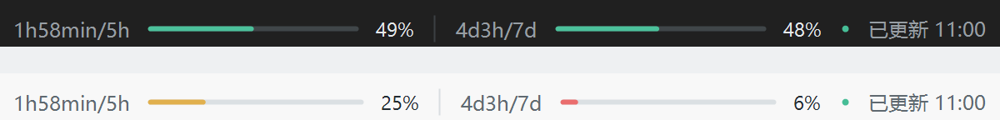

# GPT Quota Bar

[简体中文](README.md)

A standalone Windows utility that displays Codex subscription quota in the unused top menu area of the ChatGPT / Codex desktop app. This is an unofficial project.

## Features



```text
1h58min/5h [progress] 49% | 4d3h/7d [progress] 48% · 已更新 10:40
```

- Shows reset countdowns, remaining progress bars and percentages for the 5-hour and 7-day windows, followed by the last successful update time.
- Uses 12 DIP text and equal-length progress bars beside the host menus. Dark and light themes are available; the interface is currently Chinese.
- Moves, minimizes and restores with the host. Mouse input passes through without activating the bar. Narrow windows first omit the timestamp, then hide the bar.
- Supports Windows logon startup. A watcher waits for GPT to open and keeps waiting after GPT closes.
- Polls every 30 seconds in the foreground and every 5 minutes in the background, alongside quota notifications. Countdown repainting is local, once per second. The tray menu supports immediate refresh.

These are **Codex subscription limits**, not every ChatGPT model's message limits or API billing. Missing windows and expired quota values display `--`.

## How the code works

The utility uses C#, WinForms and native Windows APIs. Most logic lives in `src/GptQuotaBar.cs`.

1. **Startup and detection:** `StartupTask` registers a current-user Windows logon task. A mutex prevents duplicate instances. `BarContext` manages the tray icon, host detection and bar visibility.
2. **Quota access:** `QuotaClient` locates the official `codex.exe`, starts `app-server`, and exchanges JSON-RPC over standard input/output. After initialization it calls `account/read` and `account/rateLimits/read`, and handles account and quota notifications. The official CLI manages authentication; this utility does not directly read `auth.json` or request an API key.
3. **Data and rendering:** `Poller` adjusts polling to foreground/background state and stops its query subprocess when GPT exits. `Snapshot` parses the two quota windows and converts used percentages into remaining percentages. `Renderer` draws countdowns, progress bars and the update timestamp.
4. **Window attachment:** `BarForm` creates a native child window with matching host DPI awareness. Windows moves it synchronously with the host. Transparent, mouse-pass-through and non-activating styles preserve input behavior. No host installation changes or code injection are required.

`src/app.manifest` declares ordinary-user privileges, Windows compatibility and DPI settings. `scripts/` contains build, verification, packaging and launcher scripts.

## Usage

### Requirements

- Windows 10 / 11 x64 and .NET Framework 4.8.
- An installed and signed-in official ChatGPT / Codex desktop app, and official `codex.exe` supporting app-server subscription quota queries. The utility searches the desktop bundle, official install locations and `PATH`.
- Authentication that returns Codex subscription limits. Run both applications as the same ordinary Windows user.

Only Windows desktop apps are supported. Host menu or protocol changes may require adaptation.

### Install and operate

1. Download the Windows x64 package from **Releases** and extract it into a permanent writable folder. If no release is available, build a package using the commands below.
2. Run `Install.cmd` to register the current-user logon task named `GPT Quota Bar` and start immediately. Administrator access and a Windows password are not required.
3. Open the GPT desktop app. The bar appears in the unused menu area.
4. Right-click the green tray icon to refresh, change theme or exit.

| Entry point | Action |
| --- | --- |
| `Install.cmd` | Register logon startup and start now |
| `Start.cmd` / `GptQuotaBar.exe` | Start once |
| `Stop.cmd` | Stop now, keeping the logon task |
| `Uninstall.cmd` | Remove the logon task and stop |

Use these launchers from the extracted runtime package. Before moving the folder, uninstall the task; install again from the new location. To remove everything, uninstall the task and delete the folder.

If the bar is missing, check the tray icon, host visibility, available menu space and CLI login. To select the CLI manually, open PowerShell in the runtime folder:

```powershell
$env:GPT_QUOTA_CODEX_PATH = (Get-Command codex.exe).Source
.\GptQuotaBar.exe
```

If `Get-Command` cannot find it, set the variable to the full path of your official `codex.exe` before starting the utility.

### Run from source

From the repository root in Windows PowerShell 5.1:

```powershell
powershell -NoProfile -ExecutionPolicy Bypass -File .\scripts\build.ps1
.\artifacts\bin\GptQuotaBar.exe
```

The build uses the Windows .NET Framework C# compiler without NuGet dependencies. To generate a complete package with the four `.cmd` launchers:

```powershell
powershell -NoProfile -ExecutionPolicy Bypass -File .\scripts\package.ps1
```

The package is written to `artifacts/releases/`. Local settings, installation records and diagnostics are stored beside the executable. They may contain private paths, real quota values or window information; do not publish the runtime directory.
