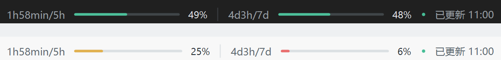

# GPT Quota Bar

[English](README.en.md)

GPT Quota Bar 是一个 Windows 小工具，在 ChatGPT / Codex 桌面应用的顶部菜单旁显示 Codex 订阅额度。当前版本为 **1.3.0**，非 OpenAI 官方产品。

## 功能介绍



```text
1h58min/5h ━━━━━━━ 49% | 4d3h/7d ━━━━━━━ 48% · 已更新 10:40
```

- 显示官方接口返回的周期、重置倒计时、剩余百分比和进度条；末尾为最近成功读取时间。
- 根据返回的数据自动显示一个或两个窗口。Pro 账号可能只返回周窗口；仅返回积分时显示积分状态。
- 剩余额度不超过 10% 时通过托盘提醒，可在托盘菜单关闭。同一周期和重置时间在程序运行期间只提醒一次。
- 额度栏固定在顶部菜单旁，随宿主窗口同步移动、最小化和恢复；点击和拖动可穿透额度栏。
- 支持深浅主题、登录 Windows 后自动启动和托盘手动刷新。前台约 30 秒、后台约 5 分钟查询，倒计时每秒在本地更新；重置后自动请求刷新。
- 未登录或额度读取失败时清空旧值并显示状态；窗口空间不足时可能省略末尾状态或隐藏额度栏。

Plus 已在作者当前电脑上验证。Pro 的单窗口和积分形态已用虚构数据测试，**尚未使用真实 Pro 账号验证**；Go 根据接口返回自适应，**尚未使用真实 Go 账号验证**。显示的是 Codex 订阅额度，不代表所有 ChatGPT 模型的消息额度或 API 账单。

## 代码运行思路

项目主要使用 C#、WinForms 和 Windows 原生接口，核心实现在 `src/GptQuotaBar.cs`：

1. **启动与监听**：`StartupTask` 为当前用户注册登录启动任务；`BarContext` 管理托盘、宿主窗口发现、显示和重置刷新。
2. **读取额度**：`QuotaClient` 启动官方 `codex.exe app-server`，通过标准输入输出请求账号状态和额度；由官方 CLI 管理认证，本工具不直接读取 `auth.json`。
3. **解析与绘制**：`Snapshot` 只取 Codex 额度桶，按接口返回的窗口时长识别和排序；`Renderer` 绘制剩余额度、积分状态、时间及错误提示。读取失败会清空旧值。
4. **窗口与进程**：`BarForm` 创建鼠标穿透、不主动抢焦点的原生子窗口，由 Windows 同步宿主移动；Job Object 尽力确保监听器退出后查询子进程随之退出。

程序优先查找用户显式指定的 `codex.exe`、桌面应用内置版本和官方本机安装目录；从 `PATH` 找到的程序必须通过 Windows 信任验证，且签名者主题包含 OpenAI。显式指定路径由使用者自行确认来源。

## 使用方法

### 运行条件

- Windows 10 / 11 x64，.NET Framework 4.8。
- 已安装官方 ChatGPT / Codex 桌面应用，以及支持 `app-server` 的官方 `codex.exe`；使用自己的 ChatGPT 账号登录。
- 账户和接口能够返回可用的 Codex 额度或积分信息。浏览器版、macOS 和 Linux 不在当前支持范围内。

### 安装、更新与卸载

1. 从仓库 **Releases** 下载 `GptQuotaBar-v1.3.0-windows-x64.zip`，解压到准备长期保留、仅当前 Windows 用户可写的文件夹。
2. 双击 `Install.cmd`，注册当前用户登录启动任务并立即启动。打开桌面应用后，额度栏显示在顶部菜单旁。
3. 右键通知区绿色图标，可立即刷新、切换主题、开关低额度提醒或退出。

| 文件 | 作用 |
| --- | --- |
| `Install.cmd` | 注册或更新登录启动，并立即运行 |
| `Start.cmd` / `GptQuotaBar.exe` | 本次运行 |
| `Stop.cmd` | 停止当前程序，保留登录启动任务 |
| `Uninstall.cmd` | 移除登录启动任务并停止程序 |

更新或移动目录时，先在旧目录运行 `Uninstall.cmd`，再解压新运行包并运行其中的 `Install.cmd`。卸载后可删除运行包目录。

如果额度栏没有出现，请检查通知区图标、桌面应用是否最小化、顶部空间是否足够，以及官方 CLI 是否已登录。必要时在当前 PowerShell 会话设置 `GPT_QUOTA_CODEX_PATH` 为官方 `codex.exe` 的完整路径，再从同一会话启动程序。

### 构建与数据

在仓库根目录运行：

```powershell
powershell -NoProfile -ExecutionPolicy Bypass -File .\scripts\verify.ps1
powershell -NoProfile -ExecutionPolicy Bypass -File .\scripts\package.ps1
```

构建使用 Windows 自带的 .NET Framework C# 编译器，无需 NuGet。运行包和校验值生成于 `artifacts/releases/`。

主题、提醒设置和诊断默认保存在 `%LOCALAPPDATA%\GptQuotaBar`；创建目录失败时回退到程序目录。安装记录不含可执行文件路径。诊断和额度快照可能包含真实使用信息，请勿公开上传。
